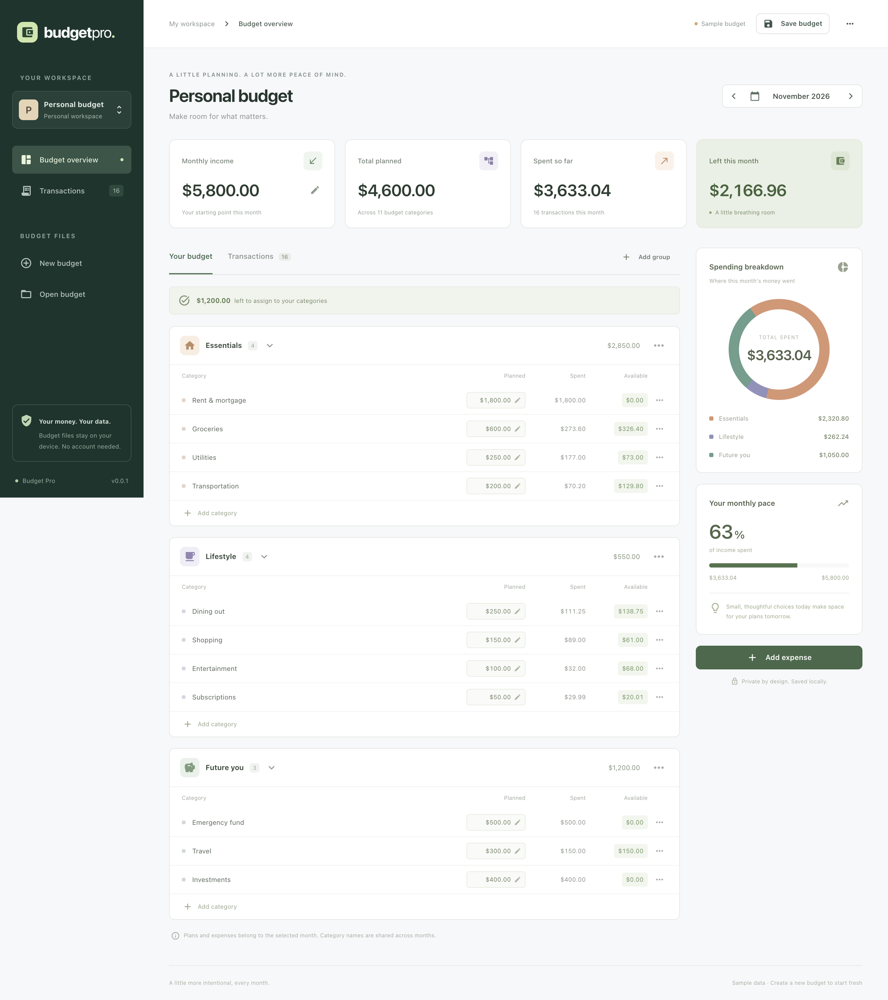

# Budget Pro

[](https://github.com/johnluscombe/budget-pro/actions/workflows/ci.yml)
[](https://github.com/johnluscombe/budget-pro/actions/workflows/ci.yml)

A personal budget desktop application built with Quasar, Vue 3, TypeScript, and Electron. Budget files stay on your device; no account or server is required.



## Get started

Use Node.js 22.12+, 24, or 26 and npm.

```bash
npm install
npm run dev
```

Quasar installs the separate Electron workspace dependencies on the first Electron launch. Electron downloads its platform runtime when first needed. For a browser preview, run `npm run dev:browser`. The `dev:electron` command remains available as an alias for `dev`.

The first launch shows clearly labeled sample data. Choose **New budget** to start an empty budget with starter categories, or **Open budget** to use an existing file.

## Budgeting

- Create, rename, and delete groups and categories. Move categories between groups without losing their monthly history.
- Select a month, set monthly income, and click a category's planned amount to edit it.
- Add, edit, search, and delete expense transactions. Expense dates must fall within the selected month.
- Monthly totals show income, planned amounts, spending, and remaining income. Each category shows its planned, spent, and available amounts.
- Plans and transactions are independent for each month. Group and category names apply to the whole file. There is no automatic rollover.
- Categories with transaction history cannot be deleted until those transactions are moved or removed.

Amounts use USD and are stored as integer cents to avoid floating point rounding errors. Savings contributions can be recorded as expenses in a savings category.

## Budget files

**Save budget** writes a versioned `.budget.json` file. **More file options → Save as…** creates another copy. File actions are also available in the native File menu with standard keyboard shortcuts. Save and Open use native desktop file dialogs.

The application automatically reopens the last successfully opened or saved file on launch. A missing or invalid file produces a recoverable message. Files are validated before use; saves replace the destination atomically. Unsaved changes prompt before creating or opening another budget and before closing the window.

The desktop renderer uses an isolated preload bridge with Node integration disabled. It cannot directly read or write arbitrary files. Only the recent file path is stored in Electron's application data directory; budgets are stored where you choose. Budget JSON files are ordinary unencrypted files.

The browser preview supports JSON import/download and restores its last saved copy from local storage. Native file paths, menus, and desktop close protection require Electron.

## Translations

Interface text is maintained in `src/i18n/en.ts`, including labels, accessibility text, validation messages, and native Electron menus. The app currently ships in English.

Messages are grouped by feature, with shared actions, fields, and accessibility labels under `common`. Use a dotted path to a message, such as `files.actions.saveBudget` or `editor.descriptions.plan`; section names alone are not valid translation keys.

Use the typed `t` helper from `src/i18n` instead of adding interface strings directly to components:

```ts
t("files.actions.saveBudget");
t("common.actions.optionsFor", { name: category.name });
```

Keep dynamic sentences together in the catalog with named placeholders such as `{name}`. TypeScript checks message keys and required parameters. Inserted user text is treated as plain text. Date and currency formatting use the shared `locale` in `src/i18n/index.ts`. Saved budget names, categories, and transaction details remain user data.

## Test and build

```bash
npm run typecheck
npm test                 # Vitest domain and filesystem unit tests
npm run test:coverage    # Vitest coverage collection, reported by NYC
npm run coverage:report # Regenerate NYC reports from the last coverage run
npm run test:e2e         # Build Electron, then run Playwright against it
npm run build            # Production browser build
npm run build:electron   # Package a desktop application for the current OS
```

`npm run build:electron:dir` creates an unpackaged Electron build; `npm run test:e2e:only` tests an existing build. Desktop E2E tests need an interactive desktop (or Xvfb on Linux), use isolated temporary profiles, and stub only the native file picker results. They exercise the real preload, IPC, file writes, and relaunch behavior. Screenshots and failure traces are written to `test-results/`.

Build artifacts go to `dist/`. Desktop packages are unsigned development builds; signing and distribution are separate release steps.

## Continuous integration

[GitHub Actions](https://github.com/johnluscombe/budget-pro/actions/workflows/ci.yml) runs on pushes to `main`, pull requests, and manual dispatch. It checks TypeScript, runs Vitest with coverage, builds the browser and Electron applications on Linux, and runs the Electron Playwright tests on macOS.

Each run publishes a unit coverage table in the Actions summary, downloadable HTML/LCOV coverage reports, the browser build, and Playwright screenshots and failure traces. Unit coverage covers budget logic, translation lookup, and budget file handling; it does not measure the UI E2E tests.

After the build and test jobs pass, the workflow packages desktop applications on their native operating systems. Download them under **Actions → CI → a successful workflow run → Artifacts**. Desktop artifacts are retained for 30 days:

| Download                         | Platform             | How to launch after extracting                   |
| -------------------------------- | -------------------- | ------------------------------------------------ |
| `budget-pro-darwin-arm64.tar.gz` | macOS, Apple Silicon | Open `Budget Pro.app`                            |
| `budget-pro-darwin-x64.tar.gz`   | macOS, Intel         | Open `Budget Pro.app`                            |
| `budget-pro-win32-x64.zip`       | Windows, x64         | Run `Budget Pro.exe` inside the extracted folder |
| `budget-pro-linux-x64.tar.gz`    | Linux, x64           | Run `./Budget\ Pro` inside the extracted folder  |

These are unsigned application bundles, not installers. Keep the extracted application and its supporting files together. The `.tar.gz` archives preserve executable permissions and symlinks on macOS and Linux. Artifacts belong to individual workflow runs; they are not published as GitHub Releases.

Coverage is reported locally by [NYC](https://github.com/istanbuljs/nyc). Vitest collects V8 coverage and writes Istanbul-compatible JSON to `.nyc_output/`; NYC generates the terminal table, HTML report, LCOV data, and JSON summary in `coverage/`. GitHub Actions publishes the summary and the `unit-coverage` artifact for all runs, including fork pull requests. No coverage service account, upload token, or OIDC permission is required. The README's NYC badge links to the workflow reports; NYC does not host a live percentage badge.

NYC 17.1 uses a scoped UUID 11 override in `package.json` to address its process-info dependency's security advisory while retaining the CommonJS API it uses.
